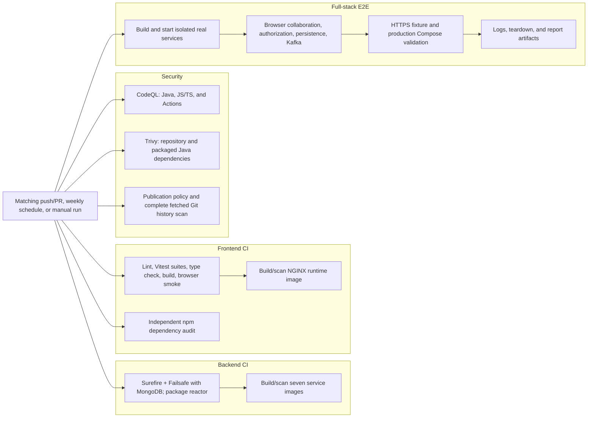
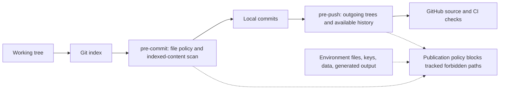

# TaskFlow CI and repository protection

[System overview](../README.md) · [Detailed checks and local commands](CI.md) ·
[Full-stack environment](e2e/README.md)

## Independent workflows and job dependencies

The four workflows run independently; E2E does not depend on a successful run of
the separate backend/frontend workflows. Within each component workflow, image
scanning depends on that workflow's test/build job. E2E cleanup/log collection
is attempted with `always()` even when earlier steps fail.

Backend, frontend, and E2E pushes/PRs use path filters; the Security workflow
has none. Schedules run Mondays at 08:23 UTC. Test/build/scanner failures fail
their jobs; high/critical dependency/source findings and any detected secret
enforce the configured security gates. Trivy reports are redacted before upload.
Required merge checks are configured separately in GitHub repository rules.

## Protection before a push

Install the pinned scanner with `python3 .github/scripts/install-gitleaks.py` from
the repository root, then enable `.githooks` as documented in the
[publishing policy](../README.md#files-safe-to-publish). The scanner lives in Git's
local metadata, outside pushed source. Hooks are local controls and can be bypassed;
CI repeats their file/secret policy after source reaches GitHub.
