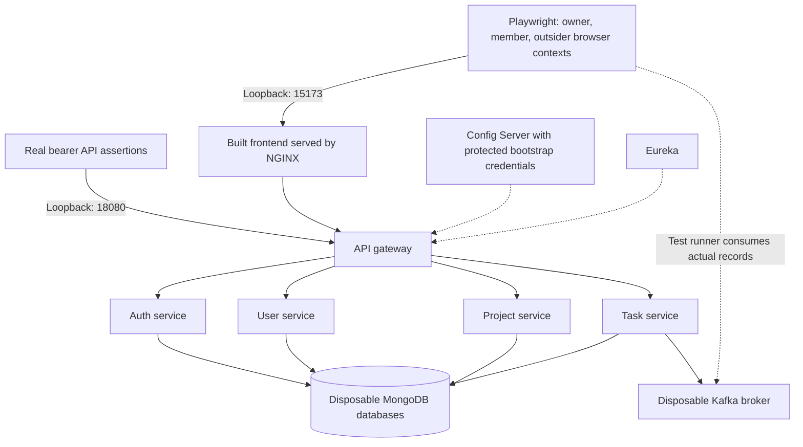
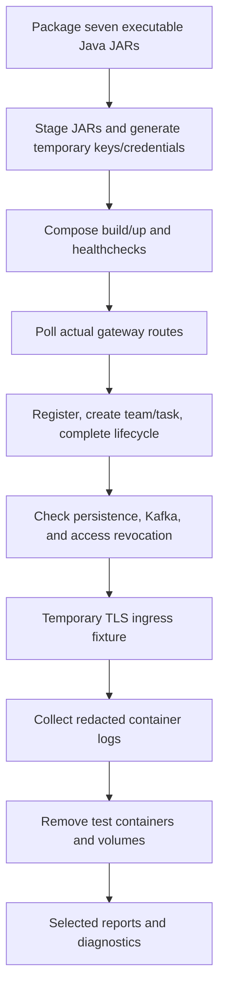

# Isolated full-stack E2E environment

[CI overview](../README.md) · [Full local procedure](../CI.md#full-stack-collaboration-test) ·
[Frontend test configuration](../../frontend/playwright.full-stack.config.ts)

## Test stack

Compose provides all ten components on its own project network and volumes.
Ports above are defaults; only the frontend/gateway are published, on loopback.
Business services use the same RSA contract and scoped secret files as the
application. The browser uses cookies and CSRF; direct API assertions use tokens
returned by real sign-in. Requests are not mocked.

## Preparation, execution, and cleanup

The workflow attempts logs/teardown after failures as well. The preparation script
creates ignored `.env.runtime`, `secrets/`, and `jars/` content. It never reads the
developer's default `.env`. Regenerate credentials only when this test stack is
stopped. Production data and credentials must never be used here.

The scenario validates outsider denials, privilege/assignment restrictions, missing
CSRF, refresh-token rejection, private-profile access, infrastructure route
exclusion, persisted task completion, dashboard progress, Kafka events, and member
removal. A separate fixture trusts a temporary test certificate and checks HTTPS,
hostname/CA rejection, headers, and rate limits with the production NGINX config.

A second browser scenario edits and reloads private profile details, rejects SVG
and external photo URLs, uploads/removes a real PNG, saves time-zone/date/start-page
preferences, and verifies that a later sign-in restores them. It also checks that
private profile fields stay out of directory responses and that actual task
deadlines use the selected time zone.

Run the [documented local procedure](../CI.md#full-stack-collaboration-test) from
the repository root. Test setup uses one worker with no scenario retries. CI
uploads selected browser reports and redacted container logs with 14-day retention;
keys, environment files, and staged JARs are outside its artifact allowlist.
