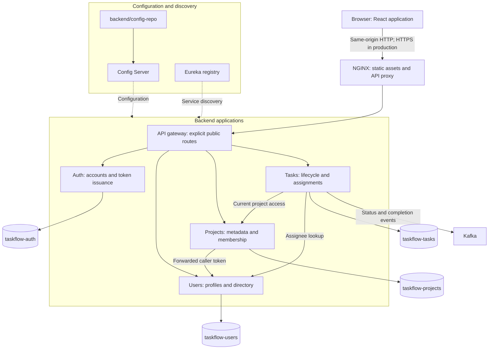
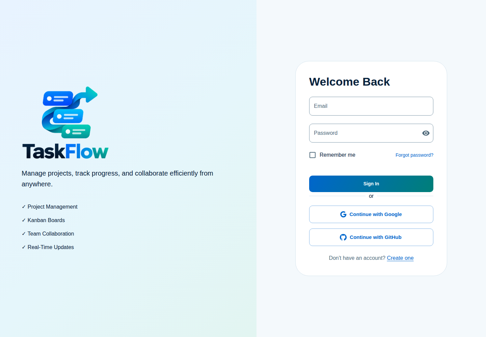
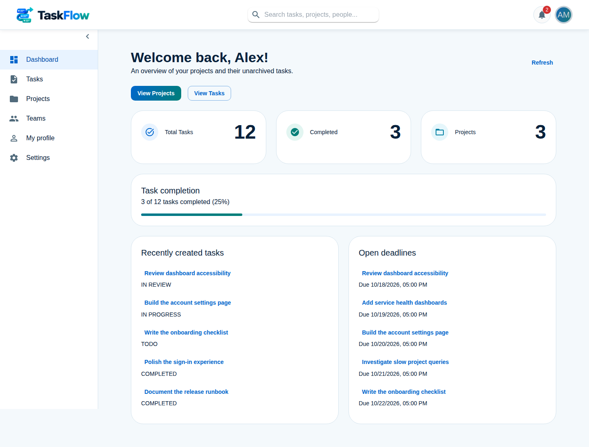
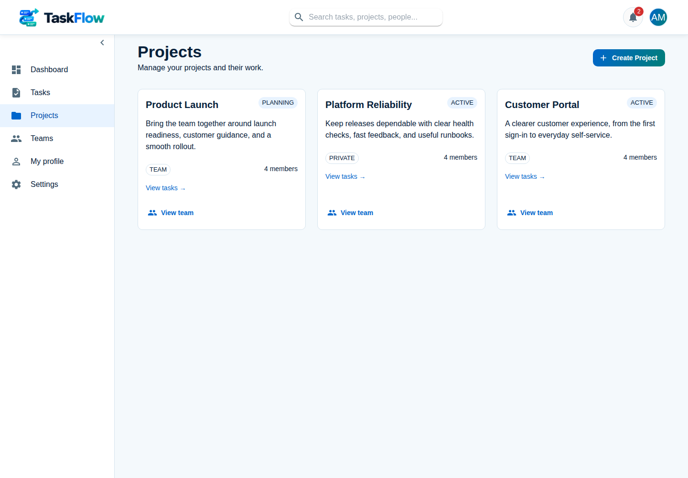
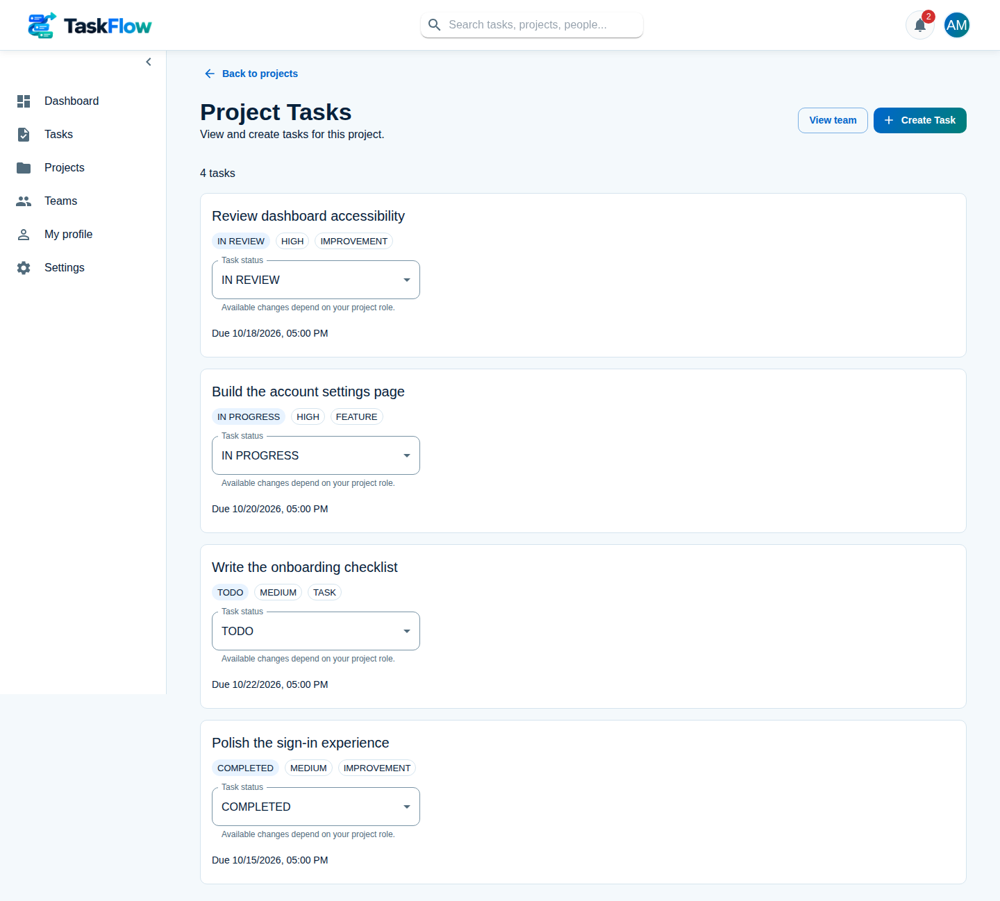
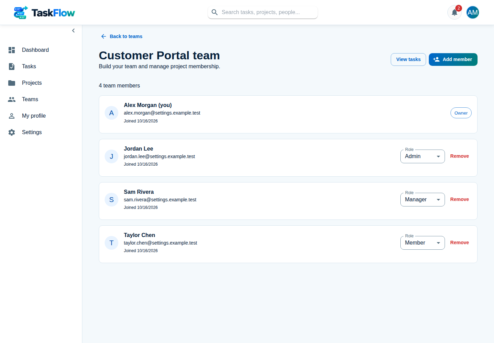
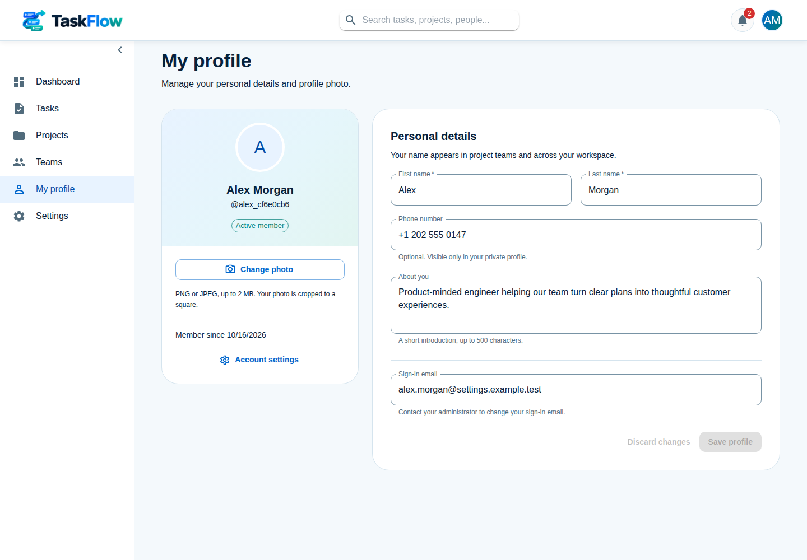
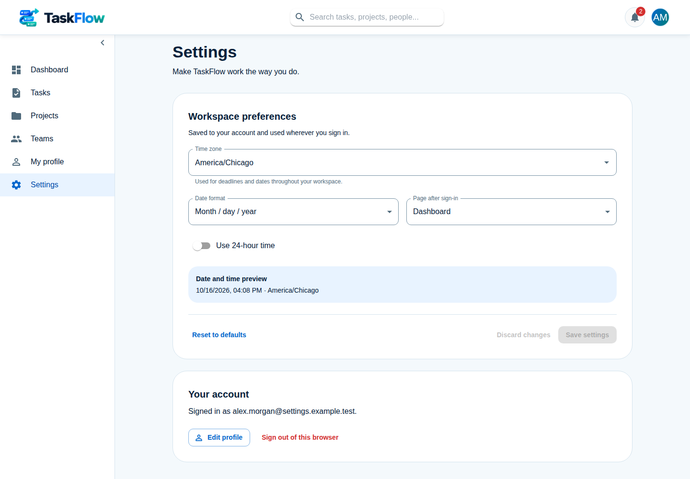

# 🚀 TaskFlow

<p align="center">
  
</p>

A cloud-native task management platform built with **React.js**, **Spring Boot Microservices**, and **MongoDB**.

TaskFlow enables users to create projects, manage teams and tasks, and track work
through a validated status workflow. The frontend communicates with four business
services through NGINX and an API gateway. Kafka carries task lifecycle events.

---

## ✨ Features

* User Registration and Login
* Editable Profiles and Profile Photos
* Saved Time Zone, Date Format, and Sign-in Page Preferences
* JWT Authentication & Authorization
* Project Management
* Task Creation, Assignment, and Tracking
* Task Status Workflow (To Do, In Progress, In Review, Completed)
* Task Priorities and Due Dates
* Dashboard with Task Metrics
* RESTful APIs
* Kafka Task Status and Completion Events
* Responsive User Interface
* Dockerized Services

---

## 🏗 Architecture



The four databases are logical MongoDB databases. Development and E2E provide a
MongoDB container; production uses separately operated MongoDB and Kafka services.
NGINX terminates production TLS and applies rate limits. Each business service
validates authentication and its resource permissions. Kafka consumers such as a
notification service remain planned work.

### System and subsystem diagrams

| Area | Documentation |
| --- | --- |
| Frontend routing, features, and browser sessions | [Frontend](frontend/README.md) |
| Backend modules and service contracts | [Backend](backend/README.md) |
| Gateway, configuration, and discovery | [Infrastructure](backend/infrastructure/README.md) |
| Identity, projects, and task workflows | [Business services](backend/services/README.md) |
| Shared modules and security components | [Commons](backend/commons/README.md) |
| Production networks, transport, and secret distribution | [Production deployment](deploy/production/README.md) |
| Build, test, and security workflows | [CI](.github/README.md) |
| Disposable full-stack test environment | [Full-stack E2E](.github/e2e/README.md) |

### Microservices

| Application | Responsibility |
| --- | --- |
| [API Gateway](backend/infrastructure/api-gateway/README.md) | Allowlisted routing, discovery resolution, and CORS |
| [Config Server](backend/infrastructure/config-server/README.md) | Native configuration repository |
| [Discovery Server](backend/infrastructure/discovery-server/README.md) | Eureka registration and discovery |
| [Auth Service](backend/services/identity/auth-service/README.md) | Credential accounts, sign-in, and token issuance |
| [User Service](backend/services/identity/user-service/README.md) | Profiles and directory summaries |
| [Project Service](backend/services/work-management/project-service/README.md) | Project metadata, membership, and access decisions |
| [Task Service](backend/services/work-management/task-service/README.md) | Task state, assignments, comments, and Kafka publication |

---

## 🛠 Tech Stack

### Frontend

* React.js
* TypeScript
* React Router
* Material UI
* Axios

### Backend

* Java 21
* Spring Boot 4.1.1
* Spring Security
* Spring Cloud Gateway (Spring Cloud 2025.1.3)
* Spring Data MongoDB
* JWT Authentication

### Database

* MongoDB

### Messaging

* Apache Kafka

### DevOps

* Docker
* Docker Compose
* Kubernetes (Planned)
* GitHub Actions

---

## 📂 Project Structure

```text
taskflow/
│
├── frontend/
│   ├── src/
│   ├── public/
│   └── package.json
│
├── backend/
│   ├── commons/                     # Shared reactor modules
│   ├── config-repo/                 # Config Server source files
│   ├── infrastructure/              # Gateway, Config Server, Eureka
│   └── services/
│       ├── identity/                # Auth and user services
│       └── work-management/         # Project and task services
│
├── deploy/production/               # Independent production Compose stack
├── .github/                         # CI, security checks, and isolated E2E
├── docker-compose.yml
└── README.md
```

---

## 📸 Screenshots

The interface follows the TaskFlow logo's blue, cyan, teal, and navy palette. Screenshots are captured from the running Docker stack with fictional demo accounts and project data.

### Login Page

TaskFlow branding and the email/password sign-in form.



### Dashboard

A personalized welcome, live project and task totals, completion progress, recent work, and upcoming deadlines.



### Projects

Project cards show status, visibility, member counts, and links to tasks and teams.



### Project Tasks

Tasks show their priority, type, deadline, and status controls governed by project permissions.



### Project Team

Project membership with an owner, admin, manager, and member, plus role management controls.



### My Profile

Edit personal details and upload or remove a profile photo. Saved names and photos appear in the account menu and workspace.



### Settings

Save the time zone, date format, clock style, and page opened after sign-in for your account.



---

## 🎯 Learning Objectives

This project demonstrates:

* Full-Stack Development
* Microservices Architecture
* REST API Design
* JWT Authentication and Authorization
* MongoDB Data Modeling
* Event-Driven Communication
* Docker Containerization
* Modern React Development
* Scalable System Design

---

## 🚀 Getting Started

### Prerequisites

* Eclipse Temurin 21.0.12.1+1
* Node.js 24.21.0 (pinned in `frontend/.nvmrc`)
* MongoDB 8.0.5 (pinned in `docker-compose.yml`)
* Docker

### Clone Repository

```bash
git clone https://github.com/herve192-hub/TaskFlow.git
cd TaskFlow
```

### Frontend

With nvm installed, the checked-in version file selects Node.js 24.21.0:

```bash
cd frontend
nvm install
nvm use
npm ci
npm run dev
```

### Backend Services

```bash
cd backend
bash ./mvnw --batch-mode --no-transfer-progress clean package -DskipTests
```

This packages the reactor. Use Compose to run the complete stack; see the
[backend guide](backend/README.md) for module boundaries and test prerequisites.

### Docker

```bash
docker compose up --build
```

The frontend runs as `taskflow-web` at http://localhost:5173. Set `FRONTEND_PORT`
in the ignored root `.env` file to change its port. Provide the local database,
port, profile, and service settings referenced by `docker-compose.yml` before
starting it. API requests default to `/` and use NGINX's same-origin proxy.
`VITE_API_BASE_URL` is a public build setting; rebuild `taskflow-web` after
changing it. Production uses the separate [deployment guide](deploy/production/README.md).

---

## Continuous integration

GitHub Actions runs backend and frontend tests and security scans. See
[the CI guide](.github/CI.md) for the checks, failure thresholds, and local commands.

### Files safe to publish

This repository's source code is public. Commit application source, tests, reviewed
configuration templates, lockfiles, build definitions, CI scripts, documentation,
and the TaskFlow logo. Keep real user/customer data and production configuration
outside the source tree. No `.env` files, including `.env.example` templates,
belong in Git. The reviewed production template is `environment.example`; copy
it to an ignored `.env` file for local deployment configuration.

The ignore rules exclude environment files, credentials, keys, local databases,
backups, dependencies, compiled output, logs, browser recordings, scanner reports,
and local editor/agent state. Docker build contexts exclude these private files
as well. Ignoring a file does not remove an already tracked file or Git history.
Frontend `VITE_*` variables are embedded in the public browser bundle; use them
only for public settings, never for passwords, keys, or private endpoints.

Install **Gitleaks 8.30.1** with the setup command below. It downloads the
[official release](https://github.com/gitleaks/gitleaks/releases/tag/v8.30.1),
verifies its published checksum and version, and installs it under Git's persistent
local metadata directory. The binary is never committed or pushed. The setup also
replaces stale scanner paths left in local Git configuration. Hooks perform no
downloads; rerun setup if the scanner is missing. Then enable the versioned hooks
and review all pending publishable files:

```bash
python3 .github/scripts/install-gitleaks.py
git config --local core.hooksPath .githooks
python3 .github/scripts/verify-publishable-files.py --include-untracked --secrets --history
git diff --cached --stat
```

For a manual installation, put the checksum-verified version on `PATH` or set
`git config --local taskflow.gitleaksPath /absolute/path/to/gitleaks` to a persistent
location. `GITLEAKS_BIN` explicitly overrides scanner selection, including in CI.

The pre-commit hook scans the actual index. The pre-push hook checks each outgoing
tree and all locally available history. Both require the pinned scanner and fail
when a forbidden file or detected secret is found; CI repeats these checks.
Hooks are local and can be bypassed, and secret scanners cannot identify every kind
of sensitive data. Review staged changes before committing and enable GitHub secret
scanning/push protection and required security checks in repository settings.
Rotate any exposed credential immediately; removing it from the next commit does
not remove it from old commits, forks, or clones.

---

## 🔐 Authentication

TaskFlow uses:

* Purpose- and Audience-Validated JWT Access Tokens
* Refresh Token Issuance with Stored Token Digests
* Spring Security
* Argon2id Password Hashing with Legacy BCrypt Migration
* HttpOnly Browser Cookies and CSRF Protection
* Role-Based Access Control (RBAC)

### Roles

* USER
* ADMIN

These platform authorities are separate from project membership roles. Production
uses RSA signing keys, Secure cookies, and administrator-controlled registration.
See [auth](backend/services/identity/auth-service/README.md),
[shared security](backend/commons/common-security/README.md), and the
[security baseline and remaining release conditions](SECURITY.md).

### Project teams

Each project has its own team. Creating a project automatically makes you its
owner. Open **Teams** in the dashboard, or select **View team** on a project,
to view members. Owners and project admins can add registered users by searching
for their name or email, assign an Admin, Manager, Member, or Guest role, and
remove members. The owner cannot be removed or have their role changed through
team management. Adding a member gives them access to the project and its tasks;
removing them revokes that access.
Registration and sign-in create a user profile when one is missing. Existing
accounts without a profile should sign in again before being added to a team.

---

## 🔮 Future Enhancements

* Real-Time Updates with WebSockets
* Notification Event Consumers
* Kanban Drag-and-Drop Board
* File Attachments
* Activity Logs
* OAuth2 (Google/GitHub Login)
* Automated deployments
* Kubernetes Deployment
* Monitoring with Prometheus & Grafana

---

## 🤝 Contributing

Contributions, issues, and feature requests are welcome.

Feel free to fork the repository and submit a pull request.

---

## 📄 License

This project is licensed under the MIT License.

---

## 👨‍💻 Author

**Herve Chendjou**

Software Engineer focused on:

* Java & Spring Boot
* React.js
* Cloud Technologies
* Microservices Architecture
* Full-Stack Development
