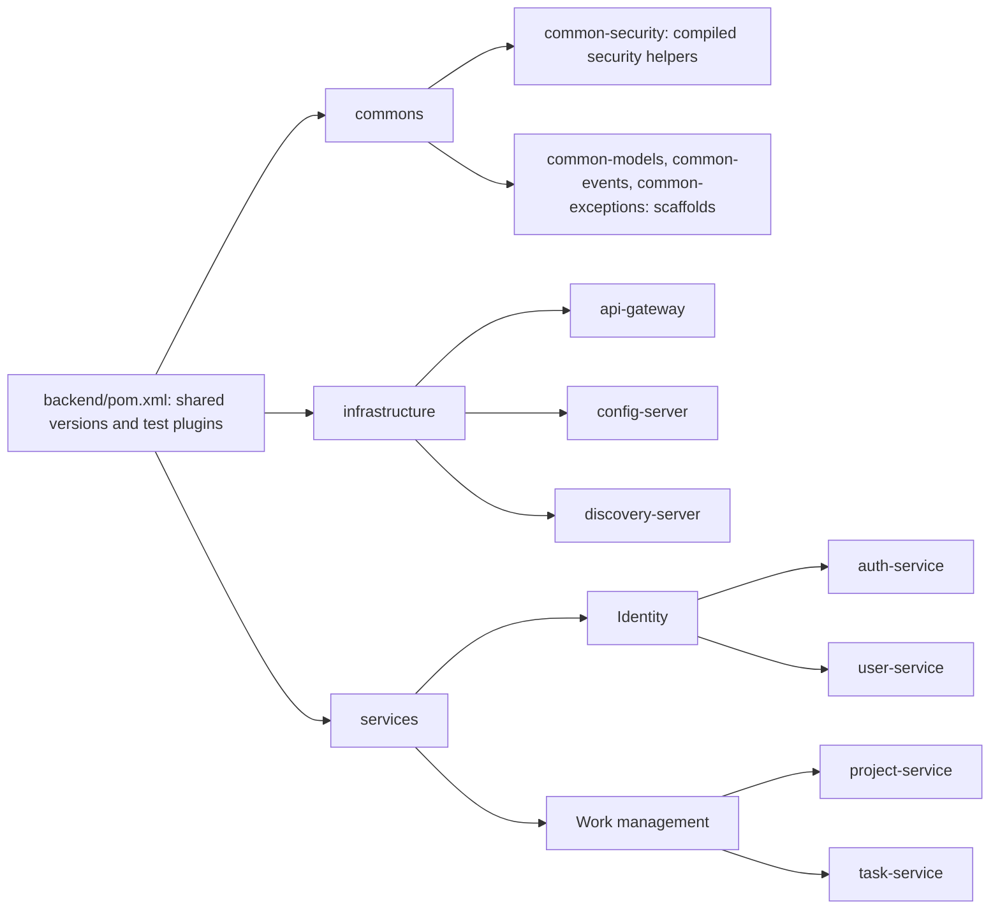

# TaskFlow backend

Java 21 / Spring Boot Maven reactor containing shared libraries, three
infrastructure applications, and four business services.
[System overview](../README.md) · [Frontend](../frontend/README.md) ·
[Production deployment](../deploy/production/README.md).

## Reactor and subsystems

Arrows below represent module aggregation, rather than runtime HTTP calls.



| Subsystem | Documentation |
| --- | --- |
| Public routing, discovery, and configuration loading | [Infrastructure](infrastructure/README.md) |
| Account/profile separation and project/task authorization | [Business services](services/README.md) |
| Shared modules and active security components | [Commons](commons/README.md) |

`config-repo/` contains the native Config Server repository. Service-named files
select logical MongoDB databases and the gateway route allowlist. Runtime properties
and scoped file secrets provide connection credentials and signing material.

## Runtime contracts

Business-service controllers derive the acting account from the validated JWT
subject. Project memberships store project-specific roles; platform
`ROLE_USER`/`ROLE_ADMIN` authorities are a separate concern. Feign clients forward
the caller's token when task/project operations consult another service.

Each business service owns its database. Cross-service identifiers are logical
references validated through HTTP calls; no foreign keys or distributed database
transactions link these stores. Task Kafka publication is asynchronous and has
no durable outbox.

## Build and test

From this directory, use the checked-in Maven wrapper:

```bash
bash ./mvnw --batch-mode --no-transfer-progress clean package -DskipTests
bash ./mvnw --batch-mode --no-transfer-progress test
```

`clean verify` adds Failsafe context and persistence integration tests, which need
the test MongoDB connection and signing configuration used by CI. The
[CI guide](../.github/CI.md) documents that environment; the
[full-stack guide](../.github/e2e/README.md) covers the real-service scenario.
Backend Dockerfiles take `backend/` as their build context to include reactor
dependencies. Production runs independently from the development Compose stack.
