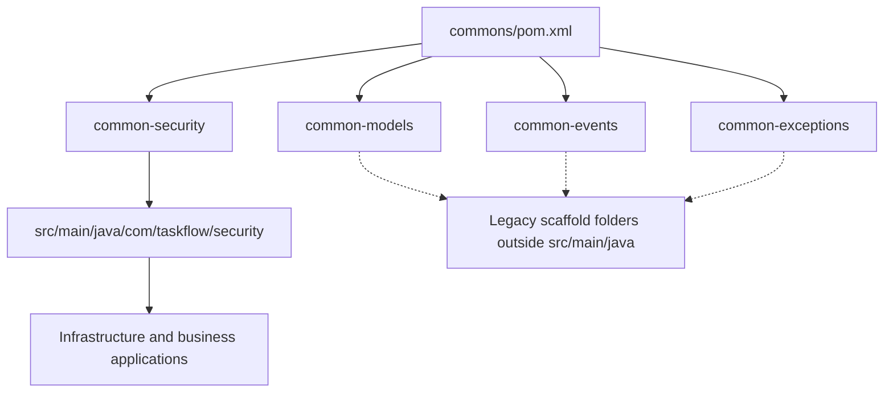

# Shared backend modules

[Backend](../README.md) · [Shared security](common-security/README.md)

## Module layout

`common-security/src/main/java` contains active shared security code. The model,
event, and exception modules contain scaffold classes outside Maven's standard
source root. The older `common-security/security/` folder is also a scaffold; its
similarly named classes are not the runtime JWT implementation. `common-config/`
is outside the current commons module list.

Business models, exception handlers, and Kafka message records remain in their
owning service. The [security diagram](common-security/README.md) shows the shared
code actually imported by the applications.
