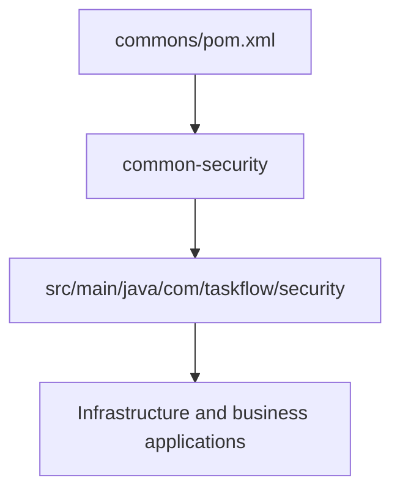

# Shared backend modules

[Backend](../README.md) · [Shared security](common-security/README.md)

## Module layout

`common-security/src/main/java` contains the shared JWT, cookie, CSRF, and production
configuration checks. It is the only shared library in the reactor. Runtime services
inherit JWT versions and executable-JAR packaging rules from `backend/pom.xml`;
the security library remains a plain JAR.

Business models, exception handlers, and Kafka message records remain in their
owning service. The [security diagram](common-security/README.md) shows the shared
code actually imported by the applications.
