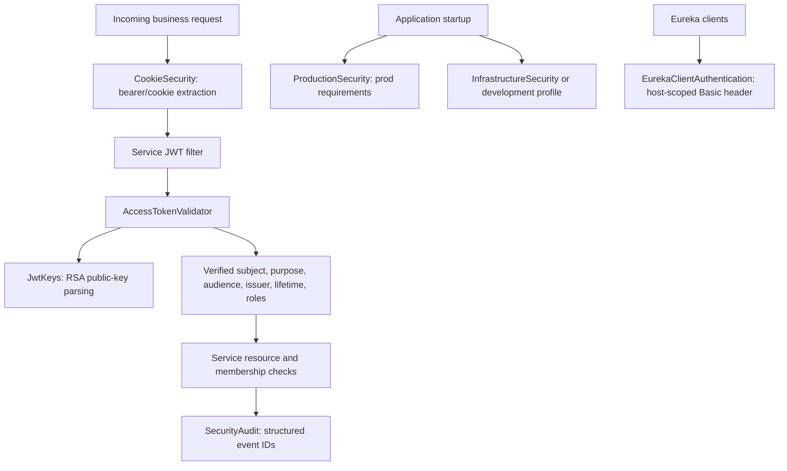

# Shared security

[Shared modules](../README.md) · [Security baseline](../../../SECURITY.md)

## Active components and consumers

`AccessTokenValidator` accepts access tokens for `taskflow-api`, with the expected
issuer, subject, identifier, timestamps, email, and platform authorities. Production
uses RS256 with RSA keys of at least 3072 bits; development can use HS512 with a
sufficiently long shared secret. Refresh-purpose tokens are rejected by this API
contract. Only auth-service receives the production signing private key.

`CookieSecurity` prefers an explicit Bearer header. Browser writes require the
CSRF nonce cookie/header pair; production authentication cookies are HttpOnly,
Secure, host-only, and SameSite=Strict. Explicit bearer clients have a separate
CSRF contract from browser-cookie clients.

`ProductionSecurity` checks configured HTTPS origin, cookie policy, registration
approval, key separation, access lifetime, MongoDB TLS, and task-service Kafka
authentication/transport. It does not verify external database privileges,
encryption at rest, or operational controls. Infrastructure authentication is
enabled for `prod` and the secure E2E profile.

`SecurityAudit` expects event names and opaque IDs. Its character/length filtering
prevents log injection; callers must exclude credentials and personal data. Resource
filters interpret verified platform claims; task-service currently establishes
`ROLE_USER` and obtains project roles separately through project-service.
