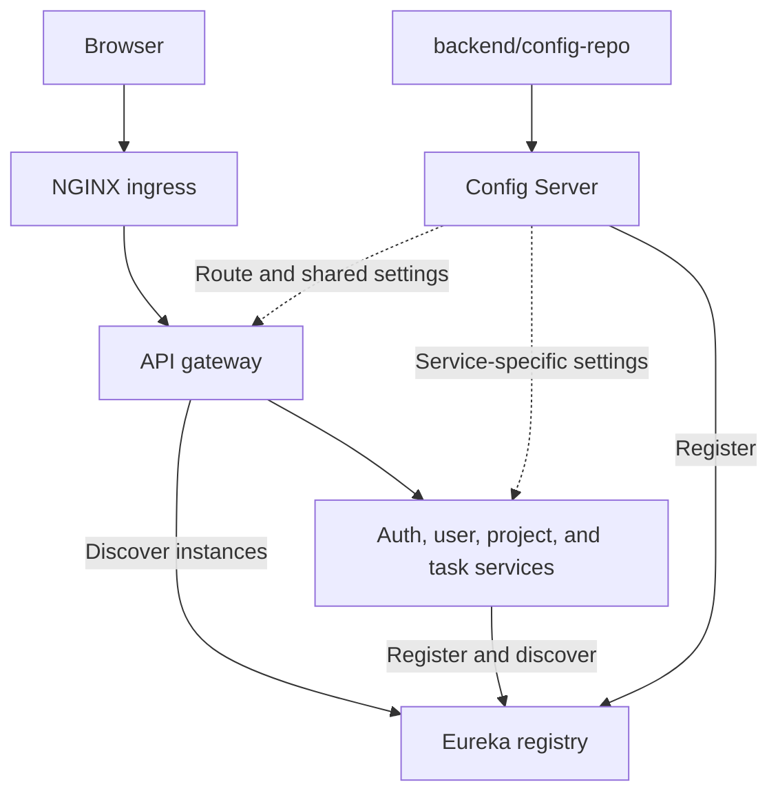

# Backend infrastructure

[Backend](../README.md) · [Business services](../services/README.md)

## Configuration, discovery, and request routing

| Application | Internal port | Detail |
| --- | --- | --- |
| [API gateway](api-gateway/README.md) | 8080 | Explicit public API routes and CORS |
| [Config Server](config-server/README.md) | 8888 | Native configuration repository |
| [Discovery Server](discovery-server/README.md) | 8761 | Eureka registry |

Production exposes HTTPS through NGINX only. Infrastructure and `/internal/**`
routes have no gateway allowlist entry. Config Server and Eureka require Basic
authentication under `prod` and the secure E2E profile. Client credentials are
loaded during bootstrap and sent in headers rather than URLs.

See the [deployment topology](../../deploy/production/README.md) for networks,
scoped secret mounts, and the trusted-host HTTP boundary.
