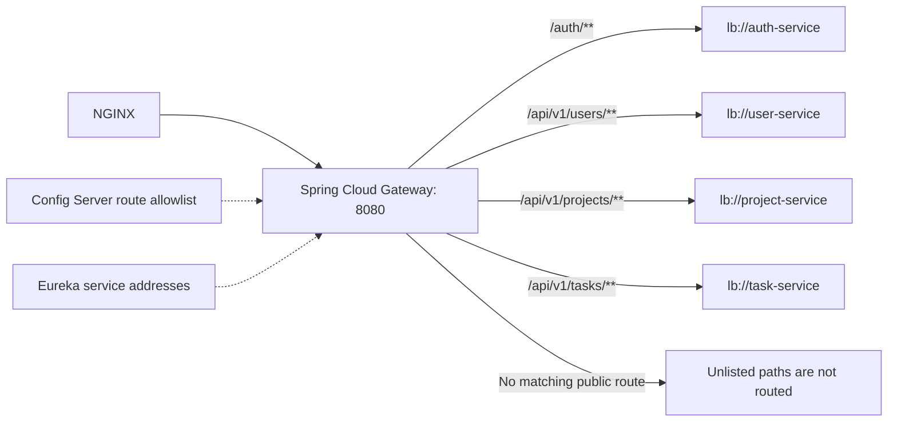

# API gateway

[Infrastructure](../README.md) · [Route configuration](../../config-repo/api-gateway.yml)

## Public routing boundary

Automatic discovery-based route publication is disabled. Eureka resolves addresses
for the configured `lb://` destinations; it does not expose every registered
application. `/internal/**`, Config Server, and Eureka are absent from the public
route list. Each business service verifies tokens and resource permissions.

`TASKFLOW_WEB_ORIGIN` supplies the credentialed browser origin. CORS permits
`X-XSRF-TOKEN`, and response-header deduplication handles headers also set by
downstream services. Production TLS and request rate limits are implemented at
[NGINX](../../../deploy/production/README.md).
