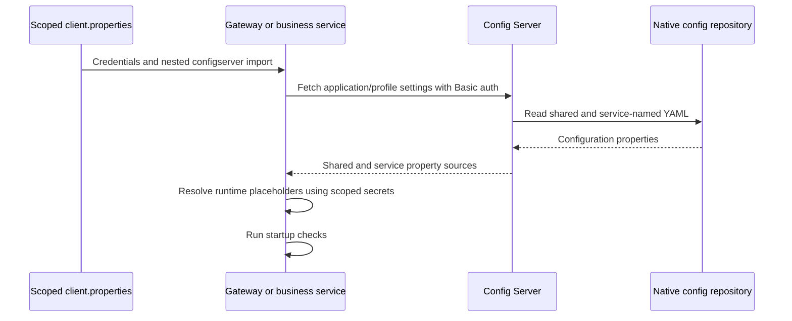

# Config Server

[Infrastructure](../README.md) · [Native repository](../../config-repo/)

## Configuration bootstrap

The server uses the `native` profile and searches `classpath:/config` and
`file:/app/config-repo`. Compose mounts `backend/config-repo` read-only at the
latter path. Source files name service databases, routes, and Kafka topics;
credential values are supplied through runtime configuration.

Protected client credentials must be available during the first fetch. The
deployment loads a property file containing both credentials and the nested
Config Server import. Infrastructure Basic authentication is enabled under
`prod` or `secure-infrastructure`; health is available for container probes.
The server listens internally on 8888 and registers with Eureka.
