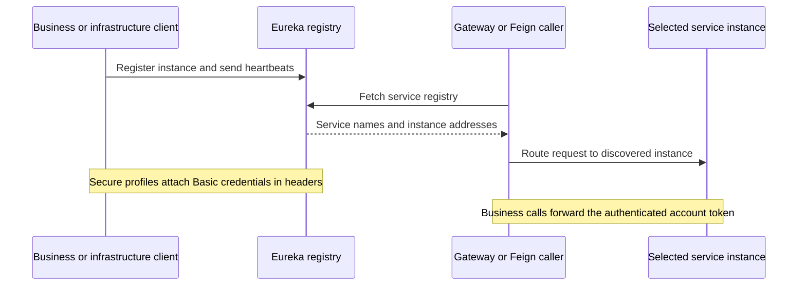

# Discovery Server

[Infrastructure](../README.md) · [Eureka client authentication](../../commons/common-security/README.md)

## Internal service discovery

The standalone registry listens internally on 8761. It neither registers with
itself nor fetches another registry. Self-preservation remains enabled.
`EurekaClientAuthentication` adds infrastructure Basic credentials only for the
configured `discovery-server` host; credentials are not embedded in URLs.

Secure profiles require authentication for registry operations, with a CSRF
exception for Eureka protocol requests and a public health endpoint. Service
discovery supplies addresses, while business authorization remains with each
service. Internal HTTP assumes the trusted Docker host/network described in the
[production guide](../../../deploy/production/README.md).
