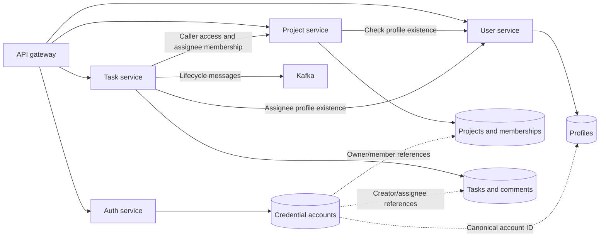

# Business services

[Backend](../README.md) · [Infrastructure](../infrastructure/README.md)

## Service interactions and data ownership

Dashed account links are logical ID relationships across service-owned databases,
not automatic joins or foreign-key enforcement. The browser initializes a missing
profile after registration/sign-in; auth-service does not directly create it.

| Subsystem | Documentation |
| --- | --- |
| Credentials, password storage, and token issuance | [Auth](identity/auth-service/README.md) |
| Profiles, directory views, and private-profile access | [Users](identity/user-service/README.md) |
| Ownership, membership, and current access decisions | [Projects](work-management/project-service/README.md) |
| Assignments, state transitions, comments, and Kafka | [Tasks](work-management/task-service/README.md) |

Platform authorities and project roles are separate. Removing a member revokes
project/task access through current membership checks. Globally revoking issued
bearer tokens is separate remaining work in the [security baseline](../../SECURITY.md).
