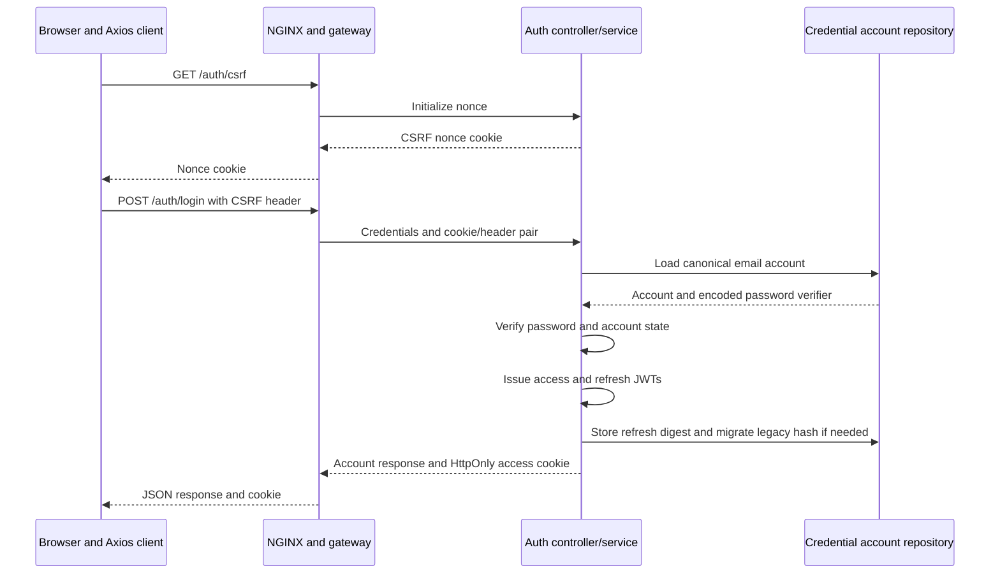
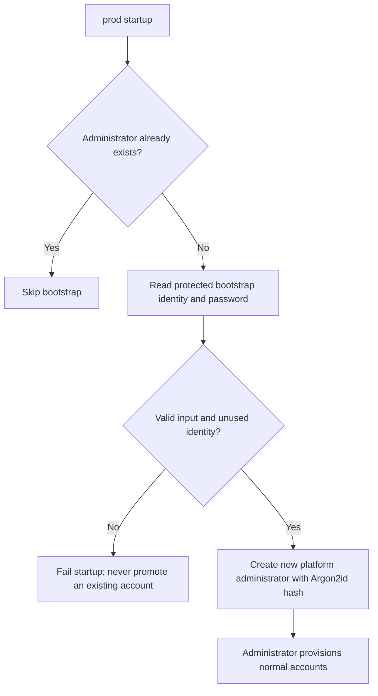

# Auth service

[Business services](../../README.md) · [Shared security](../../../commons/common-security/README.md)

Owns credential accounts in `taskflow-auth`, password verification, account
registration, and purpose-specific token issuance. The service listens on 8081.

## Sign-in and token issuance

New password hashes use Argon2id. Existing bcrypt verifiers upgrade after a
successful login. Access JWTs target `taskflow-api`; refresh JWTs have a separate
audience and purpose. The stored refresh field contains a SHA-256 digest.
The browser persists account metadata, with profile initialization performed
separately through user-service.

## Production onboarding

Production disables public registration; `POST /auth/register` requires platform
administrator authority. See the [bootstrap deployment instructions](../../../../deploy/production/README.md).
`POST /auth/logout` clears this browser's cookie; already issued bearer tokens
expire independently. Refresh-token exchange/rotation endpoints, account recovery,
MFA/SSO, and global token revocation are not implemented.
