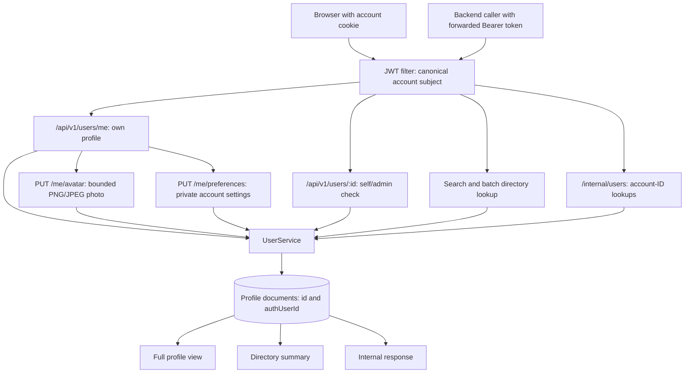

# User service

[Business services](../../README.md) · [Frontend profile initialization](../../../../frontend/README.md)

Owns profile and directory data in `taskflow-users`, separately from credential
accounts. The service listens on 8082.

## Identity, storage, and response views

`id` is the local profile document ID. `authUserId` matches the auth account/JWT
subject and is used by membership and assignment references. Profile creation
binds the submitted email to the signed account email. Full profile reads by ID
require ownership or platform administrator authority; directory summaries support
collaboration within the deployment's single organization.

Self-service updates support first/last name, phone, and bio. Email and credential
account ownership cannot be changed through profile updates. Photo updates accept
PNG/JPEG data images up to 262,144 characters and 512 pixels per side; null removes
the photo. Validation decodes the raster only after checking its dimensions, and
never fetches an external URL or accepts SVG.

Account preferences store an IANA time zone, a supported date format, 12/24-hour
time, and an allowlisted start page. Legacy profiles receive UTC and dashboard
defaults. Phone, bio, and preferences are available only in the full private
profile response; directory summaries omit them.

Directory search bounds input length and treats it as literal text. Batch lookup
accepts up to 100 canonical account IDs. Internal routes are authenticated and
absent from the gateway allowlist. Deactivating a profile changes its status only;
it does not disable the credential account or revoke issued JWTs.
