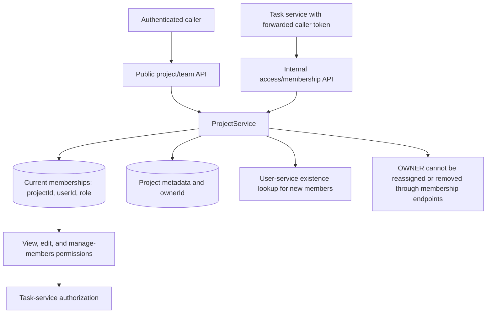

# Project service

[Business services](../../README.md) · [Task service](../task-service/README.md)

Owns project metadata and membership documents in `taskflow-projects` and listens
on 8083. Owner/member references use canonical auth-service account IDs.

## Project and membership decisions

| Project role | View project/team | Edit project details | Manage members | Delete project |
| --- | --- | --- | --- | --- |
| OWNER | Yes | Yes | Yes | Recorded owner only |
| ADMIN | Yes | Yes | Yes | No |
| MANAGER | Yes | Yes | No | No |
| MEMBER / GUEST | Yes | No | No | No |

Creation establishes the owner membership. Listing/search scopes the project
query to memberships before pagination. `memberId` in edit/remove URLs identifies
the membership document, while the member's `userId` identifies its auth account.
Nested operations verify that the membership belongs to the requested project.

The internal access endpoint derives the caller from the forwarded token and
returns denied permissions for a non-member. Visibility is stored metadata;
retrieval still requires membership. These project roles are independent of
platform `ROLE_USER`/`ROLE_ADMIN` authorities.
