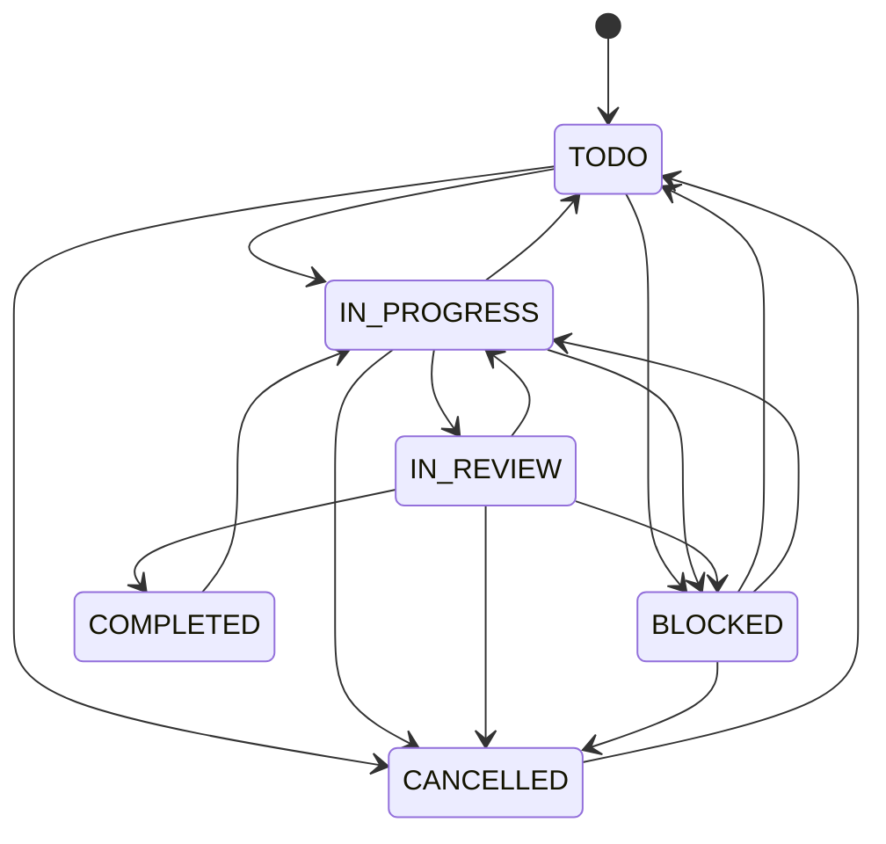
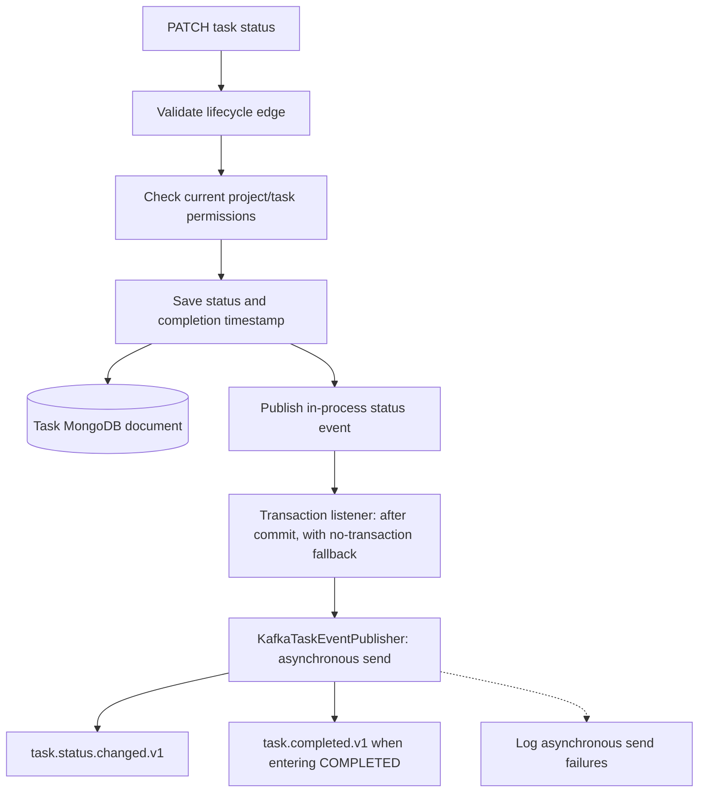

# Task service

[Business services](../../README.md) · [Project permissions](../project-service/README.md)

Owns tasks/comments in `taskflow-tasks`, consults project/user services using the
forwarded caller token, and publishes Kafka lifecycle messages. It listens on 8084.

## Task lifecycle

These are the edges enforced by `TaskLifecyclePolicy`. New tasks start in TODO;
COMPLETED and CANCELLED remain reopenable rather than terminal states.

Lifecycle validity and authorization are separate checks. OWNER/ADMIN/MANAGER
project roles may manage tasks, assignments, cancellation, and reopening. Regular
members can create tasks and modify/change status on tasks they created or are
assigned, subject to the lifecycle and management-only restrictions. Guests cannot
create or modify task fields. Current comment endpoints require project view
access. The task JWT filter currently establishes `ROLE_USER`; project roles are
resolved through project-service.

## Persistence and event publication

Messages contain event type/version and task/project/account IDs; task ID is the
partition key. A completion emits both transition and completion messages. This
is not a durable outbox or an atomic MongoDB/Kafka transaction, even with producer
idempotence. Kafka consumers and notification delivery are future work.

Delete/archive operations retain the task document. Normal project queries exclude
archived tasks; restoration uses a separate management-only lookup. Generic field
updates still enforce assignment permissions and cannot replace the dedicated
status operation. The [full-stack scenario](../../../../.github/e2e/README.md)
checks assignment, transitions, persistence, Kafka delivery, and access revocation.
