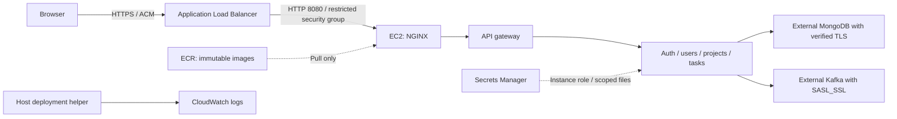

# TaskFlow on AWS EC2

This deployment runs the production Compose stack on one Amazon Linux 2023
x86_64 EC2 host. An Application Load Balancer (ALB) terminates HTTPS with an
existing ACM certificate. Its security group alone can reach NGINX on port 8080.
Administration uses Systems Manager Session Manager, with no SSH ingress.



The ALB spans two availability zones; the application host remains a single point
of failure. Releases recreate containers and have downtime. HTTP from ALB to
NGINX relies on the trusted VPC/security groups; internal application HTTP keeps
the production stack's trusted Docker network boundary. No databases, brokers,
backups, data migrations, or autoscaling are provisioned here.

## Terraform file layout

Resources in `terraform/` are grouped by AWS service: `cloudwatch.tf`, `iam.tf`,
`lb.tf`, `s3.tf`, `security.tf`, `ec2.tf`, `ecr.tf`, `kms.tf`, and `route53.tf`.
Security groups and all their ingress/egress rules live together in `security.tf`;
the instance and its Elastic IP live together in `ec2.tf`.
Shared data sources are in `data.tf`, expressions in `locals.tf`, and AWS provider
configuration in `providers.tf`. Version constraints, inputs, and outputs remain
in `versions.tf`, `variables.tf`, and `outputs.tf`. All files belong to the same
module and preserve the existing resource addresses.

## Prerequisites

- AWS CLI v2 authentication, Terraform 1.10+, Docker, Python 3, and Compose
  2.24.4+ on the build machine. Host setup installs Docker, AWS CLI, Python, and
  checksum-verified Compose 2.39.4.
- An existing VPC with DNS resolution, an Internet Gateway, and two **public**
  subnets in different availability zones. Each needs an Internet Gateway route,
  sufficient ALB address capacity, and compatible network ACLs. EC2 uses the
  first subnet and an Elastic IP for stable outbound traffic. Its public IP has
  no public application or SSH ingress. This design does not need a NAT Gateway
  and does not create or modify your VPC routes.
- A hostname and **issued ACM certificate in the deployment region** covering
  it. Supply a public Route 53 zone ID for an automatic alias, or configure DNS
  to the ALB yourself. Preserve ACM validation records for certificate renewal.
- Separately operated MongoDB and Kafka. Use four scoped MongoDB accounts and
  databases, verified TLS, and authenticated Kafka with `SASL_SSL`, as described
  in [production deployment](../production/README.md). Configure provider network
  access for the EC2 Elastic IP or your private VPC connectivity. Supply all
  endpoint CIDRs/ports in `data_egress_rules`, including advertised Kafka brokers;
  update rules when provider addresses change. Other host egress permits HTTPS
  only, for AWS APIs, image layers, and bootstrap downloads.
- An operator role for Terraform/SSM and a publisher role with ECR push and
  `s3:PutObject` on the release bucket's `releases/*` prefix and
  `kms:GenerateDataKey` on the output `release_kms_key_arn`. The publisher needs
  `ecr:GetAuthorizationToken`, `ecr:DescribeImages`,
  `ecr:BatchCheckLayerAvailability`, `ecr:InitiateLayerUpload`,
  `ecr:UploadLayerPart`, `ecr:CompleteLayerUpload`, and `ecr:PutImage` on the eight
  repositories (authorization tokens require resource `*`). The host role has
  ECR pull, specific secret reads, release downloads, log writes, and SSM access;
  it cannot publish releases.

The default `t3.large` has room for the existing container memory limits. Measure
CPU, memory, disk, and traffic before choosing production capacity. EC2, ALB,
Elastic IP, EBS, S3, ECR, Secrets Manager, and CloudWatch incur AWS charges.

## 1. Store runtime secrets

Create an existing Secrets Manager **SecretString containing a JSON object**
with exactly these properties and string values. Use your protected secret
management workflow; never commit values, pass them as shell arguments, or put
them in Terraform variables. Encode PEM newlines as `\n` in JSON. Use fresh
production credentials and databases.

| JSON property | Value |
| --- | --- |
| `jwt.private-key` | PKCS#8 RSA private key, at least 3072 bits |
| `jwt.public-key` | Matching X.509 PEM RSA public key |
| `spring.security.user.name` | Infrastructure username: letters, digits, `.`, `_`, or `-` |
| `spring.security.user.password` | Random single-line infrastructure password, at least 32 characters |
| `auth.mongodb.uri` | Verified TLS URI for `taskflow-auth` |
| `user.mongodb.uri` | Verified TLS URI for `taskflow-users` |
| `project.mongodb.uri` | Verified TLS URI for `taskflow-projects` |
| `task.mongodb.uri` | Verified TLS URI for `taskflow-tasks` |
| `spring.kafka.bootstrap-servers` | Reachable production brokers |
| `spring.kafka.properties.security.protocol` | `SASL_SSL` |
| `spring.kafka.properties.sasl.mechanism` | Broker's supported SASL mechanism |
| `spring.kafka.properties.sasl.jaas.config` | Matching JAAS login configuration and credentials |

The helper generates authenticated Config Server properties and the credential-free
Eureka URL. Backend files use UID/GID 10001 and mode `0400` inside a root-only
directory on encrypted EBS. Compose mounts each service's required files only.
Terraform stores secret ARNs, not values. Customer-managed secret encryption
also requires `secret_kms_key_arns` and a KMS key policy permitting the instance
role to decrypt through Secrets Manager.

For the first administrator, create a **separate** JSON secret with exactly
`taskflow.bootstrap.admin.email` and `taskflow.bootstrap.admin.password`. Use a
unique password of 15–128 characters and a fresh production auth database.
Supply its ARN as `bootstrap_secret_arn`. Public registration remains disabled;
administrators provision accounts through the authenticated API.

## 2. Prepare and review infrastructure

From the repository root, after authenticating AWS CLI to the intended account:

```bash
cd deploy/aws/terraform
cp settings.example terraform.tfvars
# Edit terraform.tfvars: VPC, subnets, domain, ACM certificate, and secret ARNs.
terraform init
terraform fmt -check
terraform validate
terraform plan -out=production.tfplan
# Review account, region, resources, network rules, and costs before applying.
terraform apply production.tfplan
terraform output -json deployment > /tmp/taskflow-deployment.json
cd ../../..
```

The module creates immutable ECR repositories with scan-on-push, a private
KMS-encrypted/versioned release bucket, encrypted EC2/EBS and an Elastic IP, IAM
permissions, ALB/listeners/health checks, CloudWatch logs with 30-day retention,
and EC2/ALB health alarms. Set `alarm_topic_arns` for notifications; empty topics
create alarms without notifications. ALB deletion and EC2 termination protection
are enabled by default.

The Terraform security scan has two resource-scoped exceptions: the ALB is
intentionally public, and host HTTPS egress reaches public AWS/bootstrap endpoints.
Database/broker egress remains restricted to the configured CIDRs and ports.

Pin the reviewed AL2023 AMI using `ami_id` after the first plan. The default
public SSM AMI parameter tracks updates and can trigger replacement on future
plans. Review infrastructure replacement separately from application releases.
For shared operation, configure an encrypted, restricted Terraform remote state
backend with locking before applying. Local state, tfvars, and plans are ignored
by Git.

## 3. Publish a release

Commit reviewed changes and require the repository's build, security, and
full-stack checks to pass. From a **clean checkout** on the build machine:

```bash
python3 deploy/aws/taskflow.py publish \
  --settings /tmp/taskflow-deployment.json --release v1.0.0
```

The helper builds all eight images for `linux/amd64`, disables public signup in
the frontend bundle, pushes immutable tags, and resolves ECR digests. It uploads
`releases/v1.0.0.tgz` to the output `release_bucket`. Use a new release ID for
each attempt; ECR tags cannot be overwritten. Review ECR scans before installing.

The archive allowlist includes `release.json`, Compose/NGINX files, the helper,
and native service configuration from the same checkout. It excludes `.env`
files, keys, build output, and runtime secrets. The manifest contains deployment
settings/secret ARNs, not values. ECR tokens use a temporary Docker config.

## 4. Install through Session Manager

Use `instance_id`, `region`, and `release_bucket` from the Terraform output. Your
workstation needs the Session Manager CLI plugin, or use an AWS console session.

```bash
aws ssm start-session --region us-east-1 --target i-REPLACE
```

Inside the session, substitute the actual bucket and release ID:

```bash
sudo -i
cloud-init status --wait
test -f /opt/taskflow/host-ready
aws s3 cp s3://REPLACE-BUCKET/releases/v1.0.0.tgz /opt/taskflow/releases/v1.0.0.tgz
mkdir -m 0700 /opt/taskflow/releases/v1.0.0
tar --extract --gzip --no-same-owner --no-same-permissions \
  --file /opt/taskflow/releases/v1.0.0.tgz --directory /opt/taskflow/releases/v1.0.0
python3 /opt/taskflow/releases/v1.0.0/deploy/aws/taskflow.py deploy --bootstrap
```

Use `--bootstrap` only for the first administrator. On success, the helper
automatically recreates auth without bootstrap mounts and deletes those local
files. Remove `bootstrap_secret_arn` from Terraform, apply the IAM change, and
retire the bootstrap secret. Subsequent releases use `deploy` without the flag.

The helper locks concurrent deployments, pulls every image before recreating
services, waits up to ten minutes for health, and switches `/opt/taskflow/current`
only after success. EC2 performs no source checkout or build. Docker restart
policies restart installed containers after reboot. Rotation requires redeployment
to fetch current secret versions and recreate file mounts.

## 5. Verify and operate

Once DNS resolves to the ALB:

```bash
curl --fail --show-error https://taskflow.example.com/healthz
curl --head --fail --show-error https://taskflow.example.com/
```

Verify the trusted certificate, HTTPS redirect, sign-in, secure cookies, CSRF,
project/task workflow, admin provisioning, log delivery, and alarm notifications.
ALB `/healthz` checks NGINX and gateway readiness; Compose checks all eight
containers. Verify direct EC2 and backend access is blocked. Container logs go
to CloudWatch with nonblocking bounded buffers; prolonged delivery failure can
drop logs. Restrict access to these potentially sensitive logs.

ALB appends the observed client to `X-Forwarded-For`. NGINX trusts only the ALB
subnet CIDRs and consumes the final address, ignoring spoofed prefixes for rate
limits. It sends HTTPS forwarding to Spring. Preserve the security group boundary
and ALB append mode; refresh release settings after subnet changes.

For failures, inspect container health in the root SSM session (`docker ps`,
`docker inspect`) and CloudWatch logs. The helper withholds captured CLI errors
because configuration errors may contain credentials. A failed update leaves
`/opt/taskflow/current` at the last successful release but can partially update
running containers. There is no automatic rollback. Reinstall the previous
extracted release:

```bash
python3 /opt/taskflow/releases/PREVIOUS-RELEASE/deploy/aws/taskflow.py deploy
```

Rollback uses previous image digests and **current** secrets; it does not revert
database changes. Retain old archives/images and test restore procedures. A
failed bootstrap may retain its mounts/files. Check whether the administrator
exists before retrying; after provisioning, deploy without the flag, verify live
auth mounts, and remove obsolete secret directories only after no containers
reference them. Never edit an extracted release in place.

Assign owners for host patching, database backup/restore, rotation, admin recovery,
capacity monitoring, and the remaining [security release conditions](../../SECURITY.md).
Replacement hosts are provisioned through Terraform and reinstalled from retained
releases. Teardown requires disabling resource protection; nonempty ECR repositories
and the release bucket are protected from forced deletion.

## Local checks

```bash
python3 .github/scripts/test-verify-production-compose.py
python3 .github/scripts/verify-production-compose.py
python3 -m unittest discover -s deploy/aws/tests -v
terraform -chdir=deploy/aws/terraform init -backend=false
terraform -chdir=deploy/aws/terraform validate
```

Compose checks cover direct TLS/AWS and normal/bootstrap variants. Release tests
cover immutable images, secret scope/permissions, archive contents, trust settings,
and bootstrap removal. CI runs the AWS NGINX fixture against the production image
for readiness, headers, forwarding spoofing, and client rate limits. These checks
do not validate live AWS execution, certificates, routes, databases, or production
deployment.

AWS references: [ALB security groups](https://docs.aws.amazon.com/elasticloadbalancing/latest/application/load-balancer-update-security-groups.html),
[forwarding headers](https://docs.aws.amazon.com/elasticloadbalancing/latest/application/x-forwarded-headers.html),
[SSM permissions](https://docs.aws.amazon.com/systems-manager/latest/userguide/setup-instance-permissions.html),
[ECR authentication](https://docs.aws.amazon.com/AmazonECR/latest/userguide/registry_auth.html),
and [secret IAM policies](https://docs.aws.amazon.com/secretsmanager/latest/userguide/auth-and-access_iam-policies.html).
