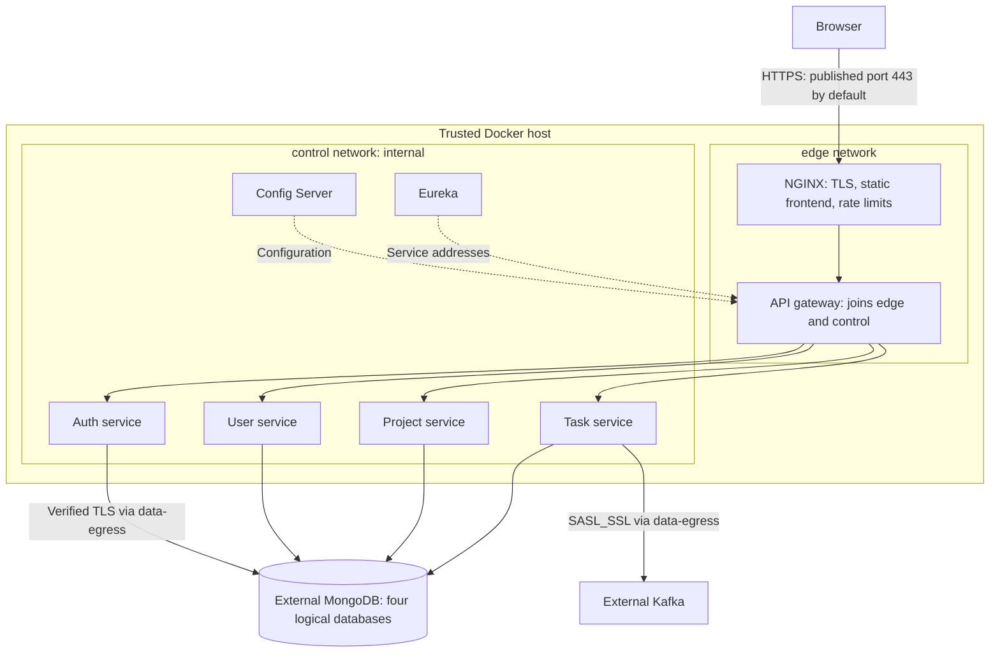
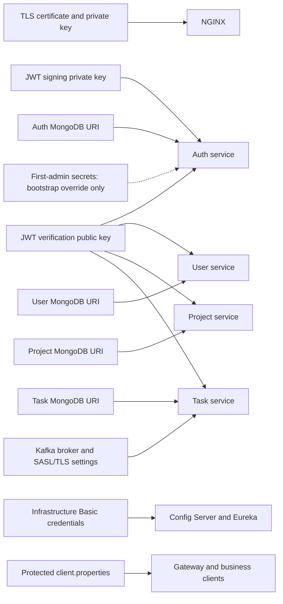

# Production deployment

This file defines the hardened application deployment for a single organization
on one trusted Docker host. Use `compose.yml` here independently from the root
development Compose file. It publishes HTTPS only; Config Server, Eureka, the
gateway, and business services have no published ports. The control network is
internal; database clients have a separate network for external data services.

Provide production MongoDB and Kafka services with verified TLS, authentication,
restricted service accounts, encryption at rest, backups, and appropriate broker
topic ACLs. The application configuration rejects plaintext MongoDB connections,
disabled certificate/hostname verification, and Kafka configurations without
SASL_SSL, a SASL mechanism, and credentials. These checks do not verify the actual
database roles, provider encryption settings, or backup policy.

## Deployment topology



| Network | Members |
| --- | --- |
| `edge` | Frontend NGINX and gateway |
| `control` (`internal: true`) | Gateway, Config Server, Eureka, and all four business services |
| `data-egress` | Auth, user, project, and task services |

All four business services also fetch configuration and register/discover instances
on `control`. Internal application HTTP relies on the trusted host/network; the
diagram's external TLS connections do not imply internal mTLS. Only the NGINX TLS
port is published. MongoDB and Kafka are operated outside this Compose stack.

## Configuration and secrets

Set `TASKFLOW_WEB_ORIGIN` to the exact HTTPS origin, including its port when it is
not 443, and set `TASKFLOW_SECRETS_DIR` to a protected directory outside source
control. Copy `environment.example` to the ignored `.env` file and update its
public settings locally. No `.env` file or `.env.example` template belongs in Git.
Supply these protected secret files:

| File | Contents / consumer |
| --- | --- |
| `jwt.private-key` | PKCS#8 RSA private key, at least 3072 bits; auth service only. |
| `jwt.public-key` | Matching X.509 PEM public key; business services. |
| `tls.certificate` | Trusted HTTPS certificate chain for the real hostname; NGINX. |
| `tls.private-key` | Separate HTTPS private key; NGINX only. |
| `spring.security.user.name` / `.password` | Infrastructure username and a random password of at least 32 characters. |
| `client.properties` | Protected client bootstrap properties containing `spring.cloud.config.username`, `spring.cloud.config.password`, and `spring.config.import=configserver:http://config-server:8888`. |
| `eureka.client.service-url.defaultZone` | `http://discovery-server:8761/eureka/`; credentials are sent in a scoped HTTP header. |
| `auth.mongodb.uri` | Verified TLS URI for an account limited to `taskflow-auth`. |
| `user.mongodb.uri` | Verified TLS URI for an account limited to `taskflow-users`. |
| `project.mongodb.uri` | Verified TLS URI for an account limited to `taskflow-projects`. |
| `task.mongodb.uri` | Verified TLS URI for an account limited to `taskflow-tasks`. |
| `spring.kafka.bootstrap-servers` | Production broker addresses. |
| `spring.kafka.properties.security.protocol` | `SASL_SSL`. |
| `spring.kafka.properties.sasl.mechanism` | The broker's supported SASL mechanism, such as `SCRAM-SHA-512`. |
| `spring.kafka.properties.sasl.jaas.config` | The corresponding client login configuration and credentials. |

Client credentials are loaded from the same property file that imports Config
Server, so they are available during the initial authenticated fetch. Service URI
files are mounted under their service-specific `AUTH_MONGO_URI`, `USER_MONGO_URI`,
`PROJECT_MONGO_URI`, or `TASK_MONGO_URI` property names. Each client's Spring
environment uses those scoped properties to resolve the connection placeholders
returned by Config Server.

### Secret distribution



The [shared security subsystem](../../backend/commons/common-security/README.md)
and [auth bootstrap](../../backend/services/identity/auth-service/README.md)
describe how these properties are validated and consumed.

Compose uses bind mounts for file secrets. Its `uid`, `gid`, and `mode` settings
cannot change ownership of those source files. Restrict the host directory and
make backend secret files readable by UID 10001, and the TLS private key readable
by NGINX UID 101, without making the private files readable to other host users.
File secret mounts do not encrypt host files at rest; use a managed secret store
and host encryption. Keep signing and TLS keys separate, and do not mount the JWT
private key into other services. Public key and certificate files may be public.

## First administrator and onboarding

Public registration is disabled in the production backend and frontend. Before
the first start, provide `taskflow.bootstrap.admin.email` and
`taskflow.bootstrap.admin.password` as protected files, with a unique password of
15–128 characters. The first deployment uses `compose.bootstrap.yml` to mount
those files into auth only. It creates a new administrator and never promotes an
existing account. Existing databases need a reviewed migration if an administrator
is not already present. Do not reuse a development or CI database for production.

After provisioning, deploy without the bootstrap override and remove the bootstrap
credential files from the running deployment. Administrators can provision normal
accounts through authenticated `POST /auth/register`; the request uses the same
CSRF protection as other cookie-authenticated writes. No public endpoint grants
administrator roles. Account recovery is currently unavailable in the application;
establish a verified administrator recovery process before deployment.

From this directory, use the pinned application image builds or independently
verified release images, then wait for every service to become healthy:

```bash
cp environment.example .env
# Edit .env locally; it must never be committed.

docker compose --env-file .env --project-name taskflow-production \
  --file compose.yml --file compose.bootstrap.yml up --build --detach --wait --wait-timeout 300

# Subsequent starts omit the bootstrap override.
docker compose --env-file .env --project-name taskflow-production \
  --file compose.yml up --build --detach --wait --wait-timeout 300
```

No production deployment has been executed by this change. The isolated CI stack
tests RSA authentication and scoped secret files, infrastructure authentication,
the collaboration workflow, CSRF and authorization failures. A separate fixture
uses this exact NGINX configuration to verify HTTPS, certificate/hostname checks,
security headers, and rate limits with a temporary certificate explicitly trusted
by the test client. It never disables certificate verification.

## Migration and release conditions

Deploy the frontend and all backend services together. Existing tokens lack the
new issuer/audience/purpose contract and users must sign in again. The browser
uses cookies rather than bearer tokens in localStorage. API clients should fetch
`GET /auth/csrf`, retain its cookie, and send the nonce as `X-XSRF-TOKEN` for initial
sign-in; subsequent bearer-authenticated API requests do not need the cookie CSRF
header. Do not stage this rollout against the old frontend without testing it.

Use the [security review](../../SECURITY.md) for the remaining release conditions.
This configuration still uses HTTP between services on a trusted, isolated Docker
bridge. Use authenticated TLS between services if that network is not trusted;
this deployment does not provide mTLS. Arrange centralized protected audit logs,
secret/key rotation, TLS renewal, database restore drills, host patching, monitored
alerts, GitHub merge protection, and an independent ASVS review. MFA/SSO and full
session revocation are not implemented. These are explicit gaps, not verified
enterprise controls.
