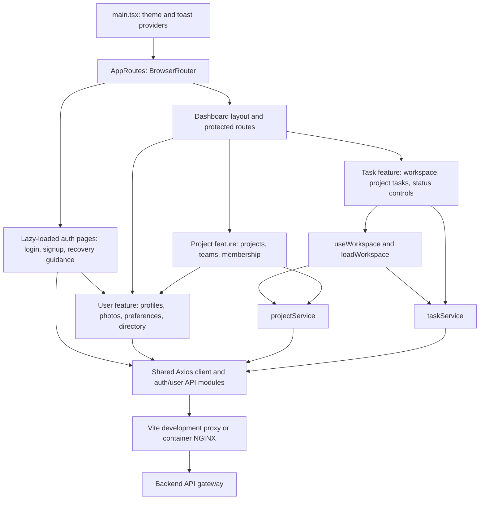
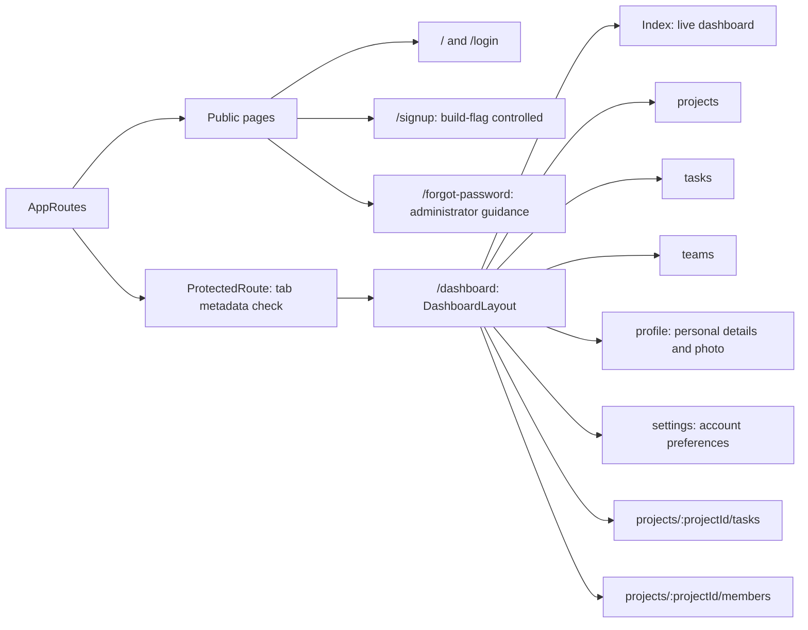
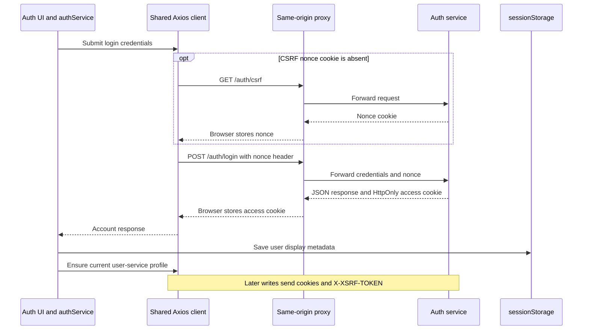

# TaskFlow frontend

React and TypeScript application built with Vite, React Router, Material UI,
Axios, and React Hook Form. [System overview](../README.md) ·
[Backend](../backend/README.md) · [Production ingress](../deploy/production/README.md).

## Application and feature boundaries



Project and task feature services own their HTTP operations directly. Auth and user
services coordinate API calls with session/profile updates. All requests share the
Axios cookie/CSRF client, and feature types describe server responses. Pages own
loading/error state and user actions. `loadWorkspace` exhausts project/task pages,
fetching tasks for at most four projects concurrently. The dashboard derives counts,
completion percentage, and deadlines from that snapshot. The header contains the
active account's profile, settings, and sign-out actions.

Routes load their page bundles on demand, so sign-in does not download every
dashboard screen. Authentication pages share their layout and password controls.
Project and task creation retain entered values on failure and prevent duplicate
submissions while a request is pending.
The shared client limits requests to 15 seconds. A root error boundary provides
reload guidance for rendering failures and unavailable route chunks without
displaying internal exception details.

## Routes and navigation



The navigation guard observes display metadata in `sessionStorage` and removes
protected screens immediately when that metadata is cleared, redirecting to
`/login`. Backend cookie validation is the authentication boundary. Account IDs from auth, profile document
IDs, and project membership document IDs are different identifiers. Membership
and assignment references use the canonical auth account ID.

Profile edits use `/api/v1/users/me`; the server determines ownership from the
authenticated account. Uploaded PNG/JPEG photos are cropped to 256 pixels square,
and the backend validates their type, dimensions, and size. Phone numbers and bios
stay out of directory summaries. Saved names/photos update the header and greeting,
and are restored from the profile service on reload and sign-in.

Settings persist time zone, date format, 24-hour time, and the page opened after
sign-in at `/api/v1/users/me/preferences`. Dashboard deadlines, task lists, and team
join dates use those preferences. Task creation labels its date input with the
device time zone. Display metadata is reactive within the tab; private phone/bio
fields are fetched for the profile page rather than cached in browser storage.

## Browser authentication and request protection



The client shares an in-flight CSRF initialization request across concurrent writes.
HTTP 401 clears tab metadata and redirects protected pages to sign-in. Access and
refresh tokens are never persisted by the session helper. Sign-out asks the server
to clear its cookie and clears tab metadata even if that request fails. Password
recovery and provider OAuth flows are not implemented.

## Local development and checks

From this directory:

```bash
nvm install
nvm use
npm ci
npm run dev
```

Vite proxies `/auth` and `/api` to `127.0.0.1:8080`. Start the backend stack
separately. `VITE_*` values are embedded in the public bundle; keep credentials in
backend secret files and never commit `.env` files. The shared logo component frames
the original artwork for full, stacked, and compact branding.

| Command | Purpose |
| --- | --- |
| `npm run lint` | ESLint checks |
| `npm run build` | TypeScript checks and Vite production bundle |
| `npm run test:unit` | Vitest utility tests |
| `npm run test:integration` | Router, active-account, and project form integration tests |
| `npm run test:ci` | Both suites with separate coverage and JUnit reports |
| `npm run test:e2e` | Chromium smoke tests against the built frontend through Vite preview |
| `npm run test:e2e:full-stack` | Real-services collaboration, profiles, preferences, and security scenarios |

Build the frontend and install the matching browser with
`npx playwright install --with-deps --only-shell chromium` before smoke tests.
The full-stack command requires the [isolated Compose environment](../.github/e2e/README.md).
See the [CI overview](../.github/README.md) for workflow relationships and reporting.
